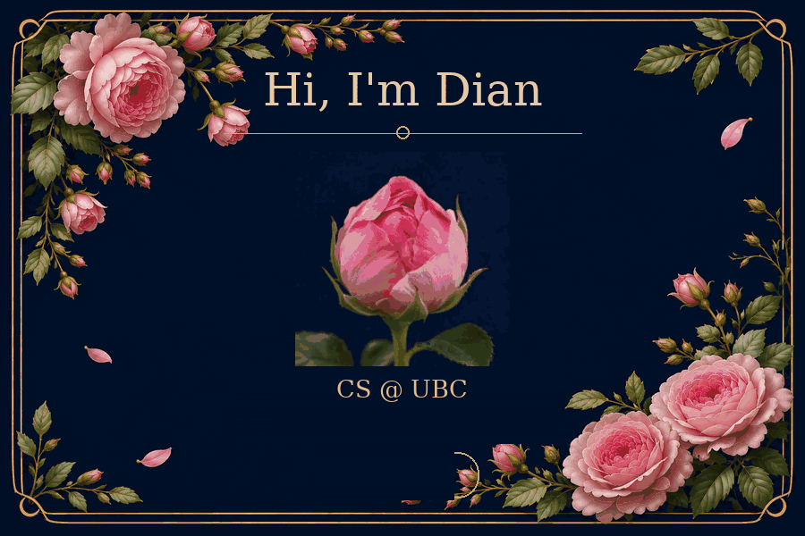

<!-- Midnight Rose · GitHub Profile README -->

  

  <a href="#about-me">About</a> &nbsp; ✦ &nbsp;
  <a href="#selected-projects">Projects</a> &nbsp; ✦ &nbsp;
  <a href="#csss-experience">CSSS Experience</a> &nbsp; ✦ &nbsp;
  <a href="https://dian-personal-website.vercel.app/">Portfolio ↗</a>

---

## About Me

<table>
  <tr>
    <td width="32%" align="center">
      
    </td>
    <td valign="middle">
      A Computer Science student at <b>UBC Vancouver</b>, passionate about building meaningful products at the intersection of software, data, and AI.
      
<b>Interests:</b> Software Engineering · Machine Learning · Data

    </td>
  </tr>
</table>

✦ &nbsp; ❀ &nbsp; ✦

## Selected Projects

<table>
<tr>
  <td width="33%" valign="top">
    
    <h3><a href="https://github.com/dian0404/AI-Image-Recognition">AI-Image-Recognition</a></h3>
    AI-powered image recognition with Python and deep learning.
    
<b>Python</b>

  </td>
  <td width="33%" valign="top">
    
    <h3><a href="https://github.com/dian0404/museum-memories">museum-memories</a></h3>
    A Java project for exploring and managing museum collections.
    
<b>Java</b>

  </td>
  <td width="33%" valign="top">
    
    <h3><a href="https://github.com/dian0404/data-science-project-planning">data-science-project-planning</a></h3>
    Data science workflow and analysis project.
    
<b>HTML</b>

  </td>
</tr>
</table>

✦ &nbsp; ❀ &nbsp; ✦

## CSSS Experience

**CSSS — External Coordinator** 
*2026 W1 – Present*

External relations, partnerships, and event coordination for the Computer Science Student Society (CSSS) at UBC.

✦ &nbsp; ❀ &nbsp; ✦

## Get in Touch

  <a href="https://github.com/dian0404">GitHub</a> &nbsp; ✦ &nbsp;
  <a href="https://www.linkedin.com/in/dian-ping/">LinkedIn</a> &nbsp; ✦ &nbsp;
  <a href="mailto:pingdian16@gmail.com">Email</a>

